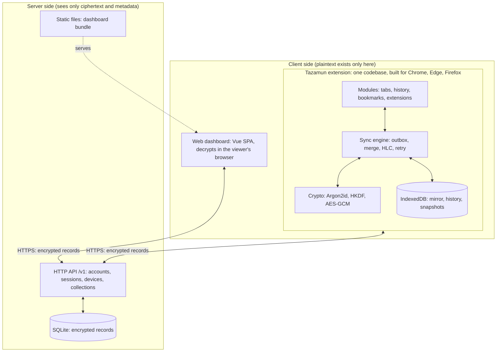
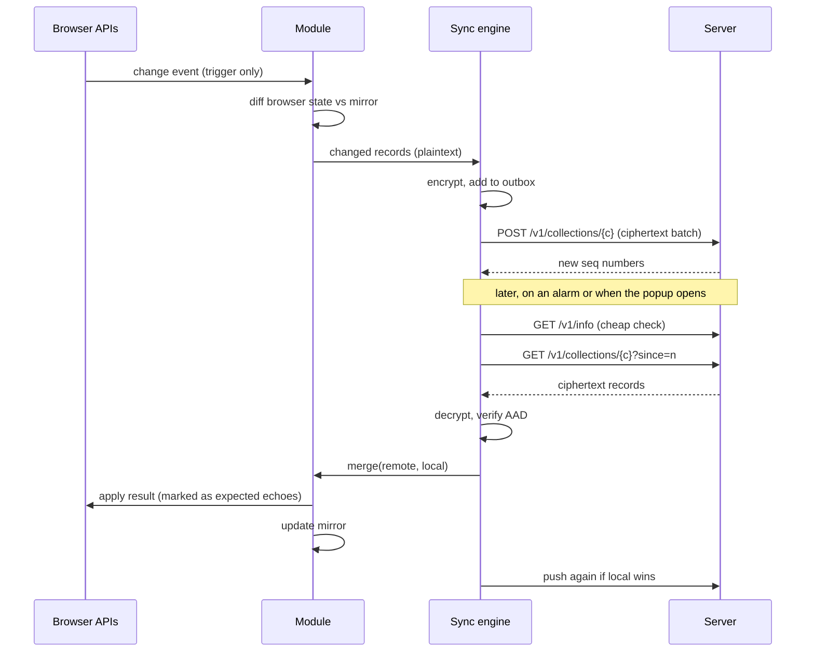

## 2. Overall Description

### 2.1 Product Perspective

Tazamun is a new, self-contained open-source product. It works alongside the browsers' own sync services (Chrome Sync, Firefox Sync, Edge Sync) but doesn't depend on them, and it works across browser families, which they don't.

#### Landscape (as of November 2026)

| Project | Covers | Gap that Tazamun fills |
| ------- | ------ | ---------------------- |
| Vendor sync (Chrome / Edge / Firefox) | Everything, but within one browser family | No cross-family sync; tied to the vendor's account. |
| floccus | Bookmarks across browsers via WebDAV, Nextcloud, Git, Google Drive, Dropbox | Bookmarks only. A separate tool and setup is still needed for tabs and history. |
| xBrowserSync | Bookmarks | Appears unmaintained. |
| Scrybe, MySync | Bookmarks/history, or tabs/bookmarks/history | Very new, with little adoption. No unified dashboard or extension inventory. |
| Tab session managers | Tab sessions | Tabs only; usually per browser. |

What sets Tazamun apart is **consolidation**: every data type in one extension, one account and one dashboard, plus an extension inventory that no other tool offers. No single feature has to beat a specialist tool. Together, they have to beat installing four tools.

### 2.2 Architecture

| Component | Responsibility |
| --------- | -------------- |
| **Core library** (`packages/core`) | Shared by the extension and the dashboard: record schemas, crypto, HLC, merge functions, the API client. Contains no browser-API code. |
| **Extension** (`apps/extension`) | One WXT project with three build targets. Hosts the sync engine and one module per data type, plus the popup, options page and address-bar keyword. |
| **Sync server** (`apps/server`) | A deliberately simple, encrypted record store with accounts, device sessions and incremental pulls. It never decrypts anything and contains no merge logic. Also serves the dashboard. |
| **Dashboard** (`apps/dashboard`) | The "one place". The user signs in with their passphrase, keys are derived in the browser, and all data is decrypted and searched there. |

**Trust boundary:** plaintext exists only inside the extension and the dashboard page. The server operator, a database dump, or someone intercepting traffic between TLS endpoints sees only ciphertext and the metadata listed in [section 5.2](<5. Other Nonfunctional Requirements.md#52-security-requirements>). See [ADR-0002](../adr/0002-end-to-end-encryption-dumb-server.md).

### 2.3 Sync Model

The full details are in [ADR-0003](../adr/0003-sync-protocol-records-hlc.md). In summary:

1. Each data type is stored as **records** in a **collection**. A record's payload is encrypted JSON. Its plaintext envelope holds only the ID, the server-assigned `seq`, size, and an optional expiry.
2. A module detects local changes by **diffing the browser's state against the mirror**. Browser events only *trigger* this diff; they are never the source of truth, because events are lost while the extension is asleep or the browser is closed.
3. Changed records go into a durable **outbox** (IndexedDB) and are pushed in batches.
4. The engine **pulls** with `since=<last seq>`. For each incoming record it calls the module's merge function, which resolves conflicts **on the client**:
   - **Last writer wins per field**, ordered by HLC (bookmarks, devices).
   - **Set union** (history visits).
   - **Whole record, owned by one device** (tabs and extension inventory: only the owning device writes it).
5. If the merge result differs from what's on the server, the device pushes it again. All devices converge without the server understanding the data.
6. Merged results are applied to the browser with **echo suppression**, and the mirror is updated.

### 2.4 Product Functions

- **Tabs:** see every browser's open tabs in one list. Send a tab to another browser.
- **History:** one searchable history across all browsers, in the extension (popup and address-bar keyword) and in the dashboard. Deletions propagate.
- **Bookmarks:** one bookmark tree kept in sync across browser families, with snapshots, a mass-deletion guard and restore.
- **Extension inventory:** a table of extensions by browser. Shows what's missing where, with store links and community-mapped equivalents.
- **Dashboard:** browse, search and manage all of the above, plus devices, passphrase, export and account deletion.
- **Control:** turn sync on or off per data type and per device, pause or resume, exclude domains, export and import.

### 2.5 User Classes and Characteristics

| Class | Description | What they need most |
| ----- | ----------- | ------------------- |
| **Multi-browser user** | Uses two or more browsers daily, e.g. Firefox at home and Edge at work. Moderately technical. | Setup in under five minutes; the feeling that nothing is ever lost. |
| **Self-hoster** | Runs the server for themself, family or a small team, usually with Docker behind a reverse proxy. | One container, clear environment variables, simple backups, low resource use. |
| **Contributor** | Developer adding modules, fixing bugs or porting. | Clear module interface, one language, fast tests, documented decisions. |

### 2.6 Operating Environment

- **Browsers:** Chrome and Edge at least 120 (MV3, 30-second minimum alarm period). Firefox at least 128 ESR. Desktop only for 1.0.
- **Server runtime:** Node.js (current LTS) inside the official OCI image `ghcr.io/proless/tazamun`, for `linux/amd64` and `linux/arm64` (including Raspberry Pi 4/5). Runs on Docker Engine with Compose v2, rootless Podman, or Kubernetes (one replica). Running without a container is supported but secondary. Full requirements in [section 3.11](<3. Software Features.md#311-self-hosting-containers-and-image-publishing>).
- **Storage for `/data`:** a local disk or block volume. Network filesystems (NFS, SMB) are not supported because SQLite locking is unreliable on them (DEP-22).
- **Server hardware (baseline):** 1 vCPU, 256 MB RAM, 1 GB disk for a small instance (up to about 10 accounts). Storage grows roughly with history volume; see [section 5.1](<5. Other Nonfunctional Requirements.md#51-performance-requirements>).
- **Database:** embedded SQLite in a single file on a mounted volume. No separate database server.
- **Network:** HTTPS is required in production, usually terminated by a reverse proxy (Caddy, Traefik, nginx). Plain HTTP is allowed only for `localhost` development.

### 2.7 Design and Implementation Constraints

- **One language:** TypeScript everywhere (extension, server, dashboard, core). See [ADR-0004](../adr/0004-typescript-monorepo-stack.md).
- **Manifest V3** on all targets. The background context may be suspended at any time, so no persistent connections and no in-memory-only state that matters. Persist to IndexedDB or `storage.local`.
- **Store policies:** no remotely hosted code; request the minimum permissions. Required: `tabs`, `storage`, `unlimitedStorage`, `alarms`, `notifications` (TAB-8) and `contextMenus` (UI-4). Optional, requested when the user turns the module on: `history` (P2), `bookmarks` (P4), `management` (P5). Optional host permission, granted for the server URL only. Adding a required permission later makes Chrome disable the extension until each user accepts it, so new permissions are optional by default. Firefox add-on review (AMO) requires buildable source when code is bundled or minified. The manifest is defined and tested in `apps/extension/src/manifest.ts`.
- **E2EE is non-negotiable:** no feature may require the server to read plaintext. A feature that seems to need it must be redesigned or rejected. See [ADR-0002](../adr/0002-end-to-end-encryption-dumb-server.md).
- **Modules are pluggable:** a data type is added by implementing the module interface ([ADR-0001](../adr/0001-one-product-module-architecture.md)). The engine must not contain type-specific code.
- **Single deployable:** the server and the dashboard ship as one container image with one data volume. Images are built and published only by CI ([ADR-0007](../adr/0007-container-distribution.md)).
- **Content Security Policy:** WASM (for Argon2id) requires `'wasm-unsafe-eval'` in the extension's CSP. No other CSP relaxation is allowed.

### 2.8 User Documentation

All documentation is Markdown in this repository, updated with every release:

- **Users:** quick start (install, create an account, pair a second browser), a feature guide per data type, a FAQ ("Why can't you sync passwords?", "What can the server operator see?"), troubleshooting.
- **Self-hosters:** Docker / Compose guide, reverse-proxy examples, configuration reference, backup and restore, upgrade notes.
- **Contributors:** `README.md`, `CONTRIBUTING.md`, the module authoring guide, ADRs, this SRS, `CLAUDE.md` (roadmap and pitfalls), changelog.

### 2.9 Assumptions and Dependencies

- Chrome, Edge and Firefox keep the `tabs`, `history`, `bookmarks`, `management`, `alarms`, `omnibox` and `storage` extension APIs broadly compatible.
- Users can remember or store a passphrase. **If the passphrase is lost and no recovery kit exists, the data can't be recovered.** This follows from E2EE and is stated during sign-up.
- Self-hosters can run a container and a reverse proxy with TLS.
- Users who keep a vendor's own bookmark sync turned on in the same browser accept the risk of two sync systems interacting (see [BMK-14](<3. Software Features.md#35-bookmarks>)).
